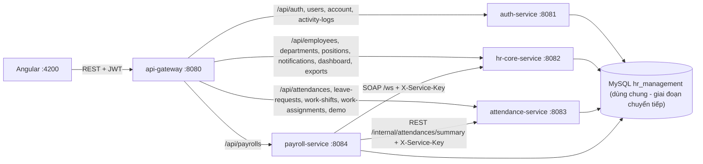

# Kiến trúc SOA – Hệ thống Quản lý Nhân sự

## Thành phần đang chạy



Thư mục `hr-management` (monolith cũ) và `hr-employee-service` là **legacy**, được giữ lại, không thuộc luồng chạy hiện tại (không nằm trong `tools/run-all.ps1`).

## Hợp đồng giữa các dịch vụ

| Bên gọi | Bên cung cấp | Giao thức | Hợp đồng |
|---|---|---|---|
| payroll-service | hr-core-service | SOAP `POST /ws` | `hr-core-service/src/main/resources/xsd/employee.xsd`, WSDL `GET /ws/employees.wsdl`. Thao tác: `getEmployeeRequest`, `getEmployeesRequest` (theo lô) |
| payroll-service | attendance-service | REST `GET /internal/attendances/summary?employeeId&month&year` | `ApiResponse<AttendanceSummaryResponse>`: `actualDays, lateDays, earlyLeaveDays, absentDays` |

Ví dụ phản hồi REST nội bộ:
```json
{"success":true,"message":"...","data":{"employeeId":1,"month":10,"year":2026,"actualDays":3,"lateDays":2,"earlyLeaveDays":1,"absentDays":0}}
```

## Xác thực giữa các dịch vụ
- Người dùng: JWT (auth-service cấp; mọi service tự kiểm bằng secret chung).
- Dịch vụ ↔ dịch vụ: header `X-Service-Key` (biến môi trường `SERVICE_API_KEY`, không lưu trong source). `ServiceKeyFilter` bảo vệ `/ws/**` (trừ `GET /ws/*.wsdl`) và `/internal/**`; chưa cấu hình khóa → từ chối tất cả.
- Gateway không định tuyến `/ws` và `/internal`, nên các đường này không truy cập được từ trình duyệt.
- `tools/run-all.ps1` tự sinh khóa ngẫu nhiên nếu bạn chưa đặt `SERVICE_API_KEY`.

## Payroll sau khi tách
- `PayrollService` không còn truy vấn bảng `employees`/`attendances`; `Payroll` chỉ lưu `employee_id` (cột cũ, không đổi schema).
- Thông tin nhân viên: SOAP (`EmployeeSoapClient`). Chấm công: REST (`AttendanceRestClient`).
- Hr-core lỗi khi xem danh sách → vẫn hiển thị bảng lương (thiếu tên); khi tạo lương → HTTP 503. Công thức lương giữ nguyên.
- Demo giao diện: màn Lương → xem chi tiết một dòng → nút **Demo SOA / SOAP** (`GET /api/payrolls/soap-demo/{employeeId}`, chỉ ADMIN; email được che).

## Chạy & kiểm thử
```powershell
.\tools\run-all.ps1          # MySQL phải đang chạy
mvn -f payroll-service\pom.xml test
mvn -f attendance-service\pom.xml test
```
Cấu hình qua biến môi trường: `SERVICE_API_KEY`, `HR_CORE_SOAP_URL`, `ATTENDANCE_SERVICE_URL`.

## Phạm vi trung thực
Đây là SOA chuyển tiếp, không phải microservices: vẫn dùng chung một database, `JwtAuthFilter` và secret JWT chung. Bước tiếp theo: OpenAPI (cần thêm thư viện, chờ xác nhận), tách schema theo service.
